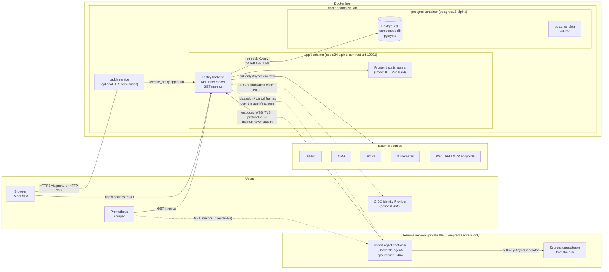
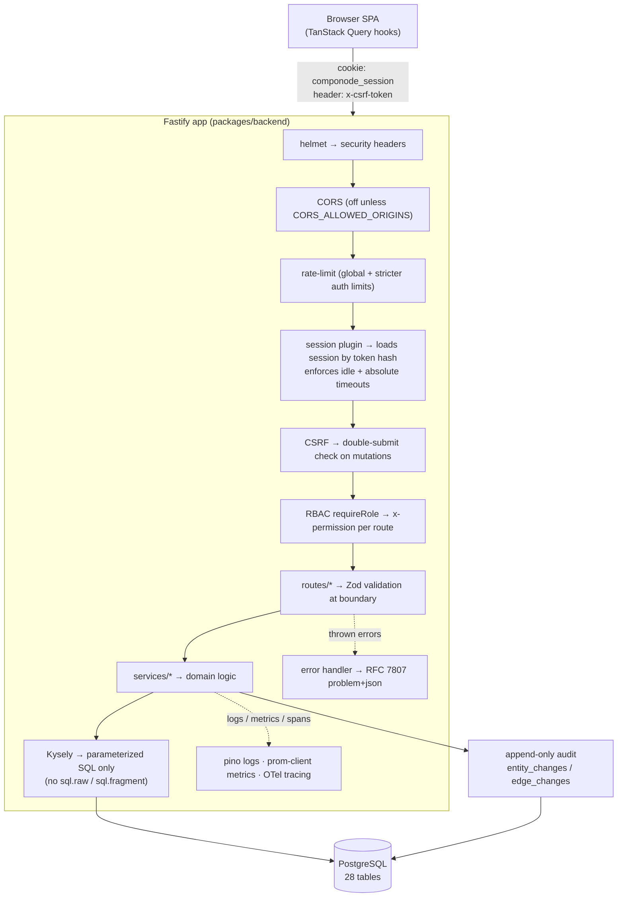
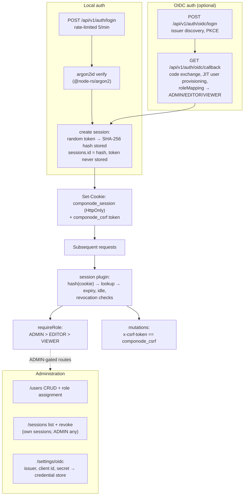
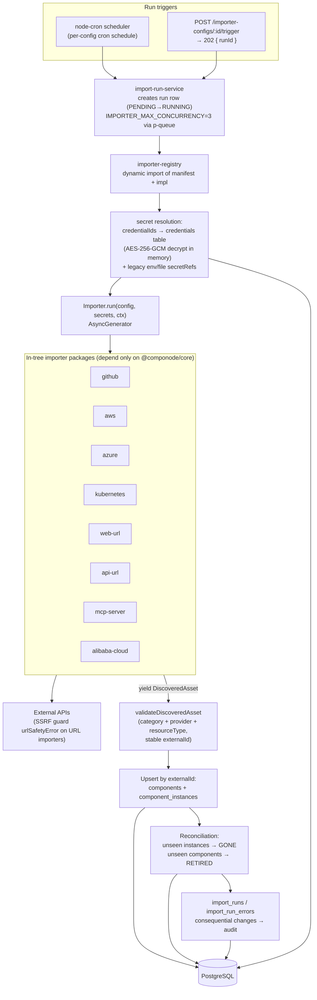
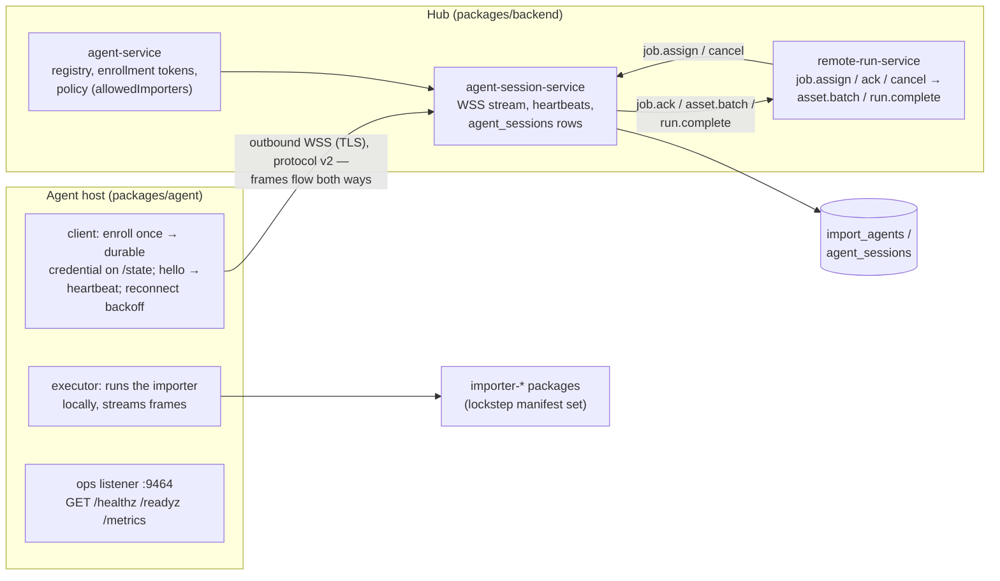
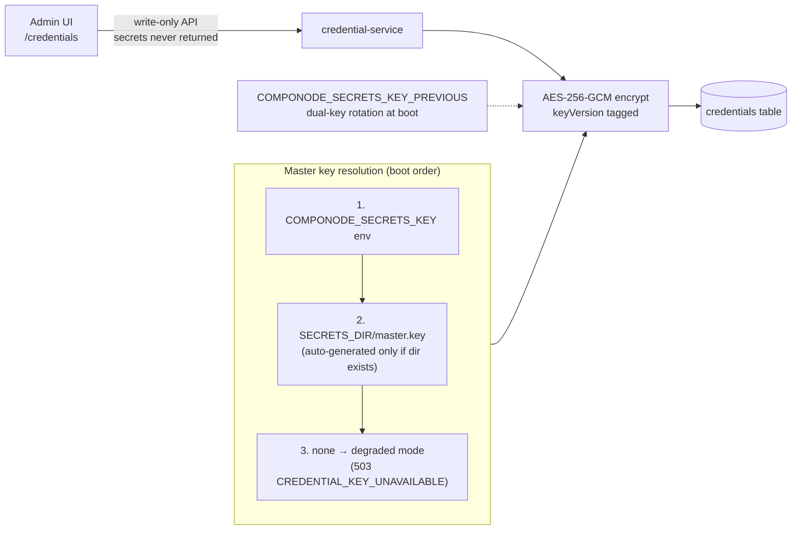
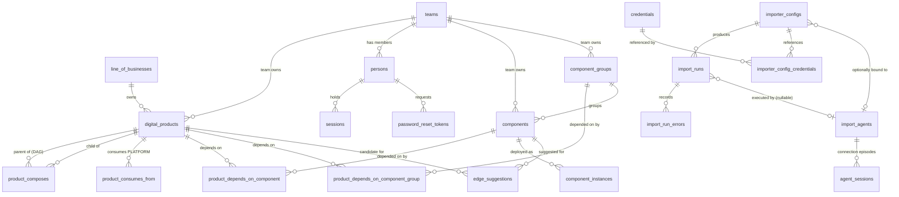
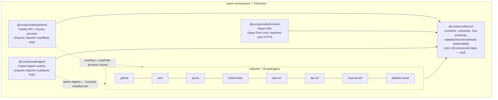

# Architecture Overview

This document describes the runtime architecture of Componode: the deployment
topology, the end-to-end data flow, authentication, the importer pipeline, and
the persistence model. It reflects the code as shipped; the *why* behind each
decision lives in `researches/architecture-decisions.md` (ADR index) and the
binding principles in `.specify/memory/constitution.md`.

## System context

Componode is a single-organization, self-hosted monolith. One Docker Compose
deployment = one organization. The backend serves the built frontend as static
assets, so the whole application is one container plus PostgreSQL.

Key infrastructure facts:

- The `app` image is a single-stage `node:24-alpine` build that runs
  `packages/backend/dist/server.js` as a non-root user and exposes port `3000`.
- PostgreSQL 16 is bundled (`postgres_data` volume); **PostgreSQL 14+** is the
  floor for external databases, and `pgcrypto` is required — both verified at
  startup before migrations run.
- `init-db.sql` creates the `componode` database and a least-privilege role on
  first boot of the bundled Postgres.
- The app **does not terminate TLS** (ADR-093). The bundled `caddy` service
  fronts it with a self-signed certificate from Caddy's internal CA
  (`tls internal`, `SITE_ADDRESS` in `.env`); `TRUSTED_PROXY_IP` defaults to
  `1` hop so `X-Forwarded-*` headers are honored, and `PUBLIC_URL` makes
  OIDC callbacks resolve to the external origin.
- `GET /api/v1/health` (liveness/readiness) and `GET /metrics` (Prometheus)
  are the only unauthenticated endpoints besides the public auth routes.
- `Dockerfile.agent` builds a second image from the same monorepo running
  `packages/agent/dist/main.js` — an Import Agent for networks the hub
  cannot reach (ADR-116). It enrolls once, persists its durable credential
  on the `/state` volume, and holds a single outbound TLS WebSocket to the
  hub. Its process-local ops listener serves `/healthz`, `/readyz`, and
  `/metrics` (GET-only, unauthenticated) on `AGENT_OPS_HOST:AGENT_OPS_PORT`
  (default `0.0.0.0:9464`); the image `HEALTHCHECK` hits `/healthz`.

## Request data flow

Every API request traverses the same plugin pipeline before reaching a route.

Conventions enforced on this path:

- All routes are under `/api/v1` except `GET /metrics` (ADR-070).
- `GET`/`HEAD` are side-effect-free on domain state (ADR-094).
- Inputs are validated with Zod at the route boundary; unknown fields are
  rejected (ADR-095).
- Errors are RFC 7807 documents (`application/problem+json`) carrying the
  controlled `code`/`message`/`details` fields; internals never leak
  (ADR-071, ADR-096).
- Default list queries exclude `RETIRED` records and `GONE` instances unless
  `includeRetired`/`includeGone` is passed.

## Authentication and authorization

- Session tokens are cryptographically random (not UUIDs — ADR-099), stored
  only as SHA-256 hashes; `tokenLast4` is kept for display matching. The API
  exposes a non-secret `publicId` for revocation.
- Self-registration exists but is off unless `allow_self_registration` is
  enabled in settings; it creates a `VIEWER` and auto-logs in.
- Password reset uses single-use, expiring tokens generated by an
  ADMIN-permitted endpoint.

## Importer pipeline

Importers are the factual layer. They are pull-only `AsyncGenerator`s that
never touch the database; the backend owns upsert, dedup, reconciliation, and
run history.

- Run statuses: `PENDING`, `RUNNING`, `COMPLETED`, `FAILED`, `CANCELLED`,
  `INTERRUPTED`. Duplicate triggers return `409 RUN_IN_PROGRESS`.
- Cancellation is cooperative via `AbortSignal` (`context.signal.aborted`).
- Optional `testSecrets` probes let users verify stored credentials without a
  full run.
- Configs can also run **remotely**: when bound to an Import Agent the hub
  dispatches the job over the agent's stream, and the streamed assets flow
  through the same validate → upsert → reconcile path — see *Import Agents*
  below.
- `DiscoveredAsset.relationships` is **not** part of the v1 contract —
  importer-declared product edges are a v2 feature.

## Import Agents (remote execution)

Import Agents (ADR-116, specs 025–028) run the same in-tree importer
packages on hosts the hub cannot reach — private VPCs, on-prem Kubernetes,
egress-only networks. Connectivity is strictly outbound: the agent opens one
TLS WebSocket to `/api/v1/agent/stream`; the hub never dials in.

- **Enrollment**: a single-use, ~24 h enrollment token is exchanged once for
  a durable credential the agent persists in `AGENT_STATE_DIR`; rotate and
  revoke are hub-side operations that drop live sessions.
- **Lockstep handshake**: `hello` must report the hub's exact importer set
  and `AGENT_PROTOCOL_VERSION` (currently `2`); a mismatch closes the stream
  and the agent image must be rebuilt from the same commit as the hub.
- **Remote runs**: a config bound to an agent dispatches `job.assign` over
  the stream (`MAX_JOBS` caps concurrency; overflow queues hub-side). Agent
  NACKs, session loss, and cancellation map to `AGENT_INCOMPATIBLE`,
  `SECRET_RESOLUTION_FAILED`, `AGENT_LOST` (remote runs are never resumed),
  or `run.complete{CANCELLED}`.
- **Agent-managed credentials** (spec 026): `AGENT_MANAGED` credentials
  store reference names only (`{env}` / `{file}`); the agent resolves them
  on its host — secret material never crosses the stream in either
  direction.
- **Ops observability** (spec 028): heartbeats carry an `ops` counter
  snapshot persisted replace-on-write to `import_agents."reportedStatus"`
  and exposed on `GET /agents`/`GET /agents/{id}` alongside
  `lastHeartbeatAt`/`lastDisconnectReason`; the agent-local listener
  mirrors the hub `/metrics` posture (unauthenticated, GET-only, no secret
  material). Full reference: `docs/agents.md`, `docs/agent-protocol.md`.

## Credential store

The OIDC client secret from **Settings → OIDC** also lives here. The database
plus the master key together form the backup unit.

## Persistence model

PostgreSQL holds 28 tables (migrations `001`–`019`). Entity IDs are UUID v7
generated application-side; enum-like fields use `CHECK` constraints driven by
`packages/core` constants rather than native ENUMs.

Edge rules enforced in the service layer:

- `COMPOSES` is a DAG — cycle attempts return `409 CYCLE_DETECTED`; any
  product type may be a parent (ADR-109).
- `CONSUMES_FROM` targets must be `PLATFORM`.
- `DEPENDS_ON` targets a concrete component or a `ComponentGroup` (expanded
  to members at read time, ADR-110); `componentIds[]` bulk form allowed.
- `edge_suggestions` stages server-generated `DEPENDS_ON` candidates —
  human-decided via accept/dismiss, never auto-wired (ADR-113).
- Audit tables (`entity_changes`, `edge_changes`) are append-only via
  database triggers (migration `002`); terminal run states are locked by
  triggers as well (migration `003`). They reference audited rows by
  polymorphic `entityType`/`entityId` rather than foreign keys.
- Not shown: `app_settings` and `oidc_config` singleton config tables, and
  the component-to-component relationship tables (`component_exposes`,
  `component_sources_from`, `component_depends_on_component`).

## Monorepo package boundaries

Hard boundaries (ADR-065): importers never import `@componode/backend` or each
other; `core` never imports anything `@componode/*`.

## Where to go next

| Topic | Document |
|---|---|
| Binding principles | `.specify/memory/constitution.md` |
| Decision rationale | `researches/architecture-decisions.md`, `researches/adrs/` |
| API surface | `docs/api.md`, `docs/openapi.yaml` |
| Deployment & ops | `docs/deployment.md` |
| Import Agents | `docs/agents.md`, `docs/agent-protocol.md` |
| Building an importer | `docs/importer-development.md` |
| UI conventions | `docs/ux.md` |
| Security posture | `docs/security/` (dated assessments) |
