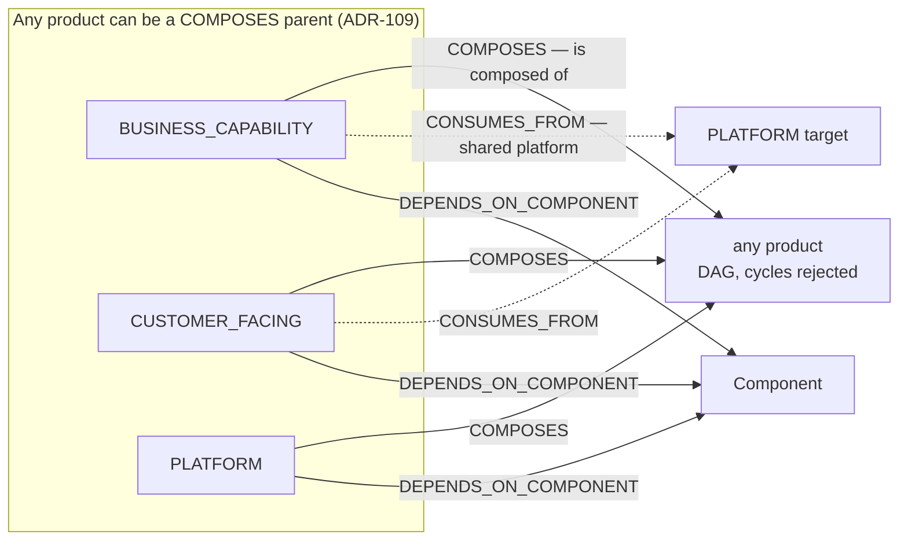
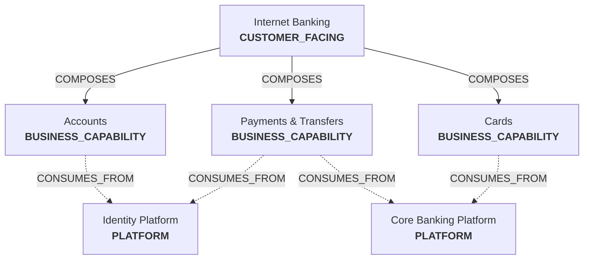
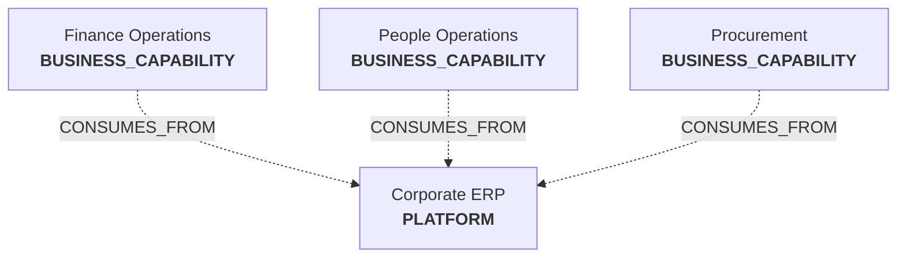
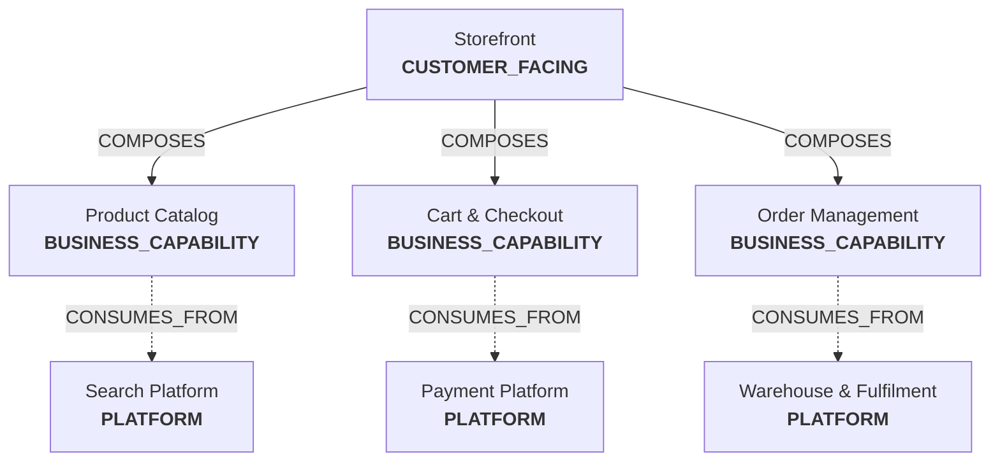
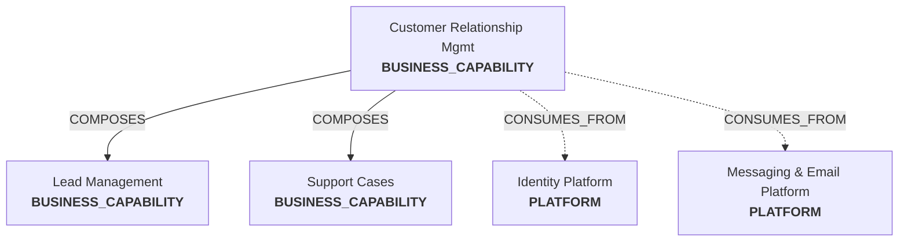
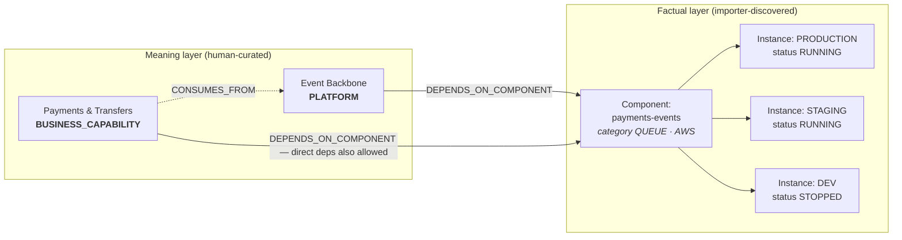
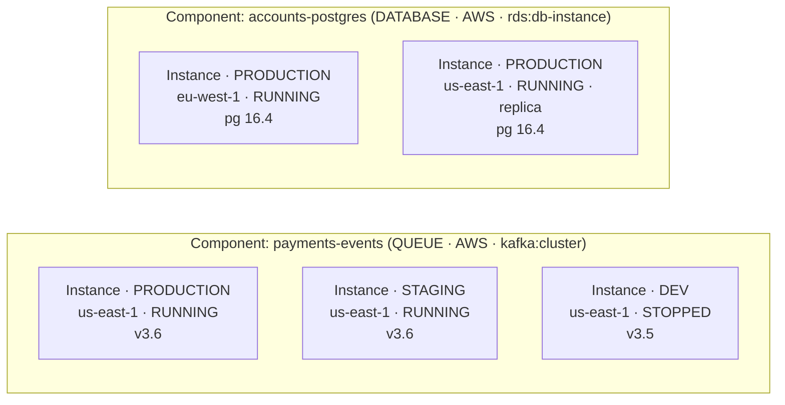
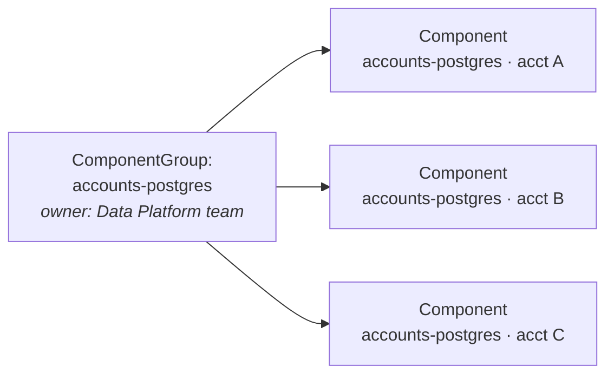
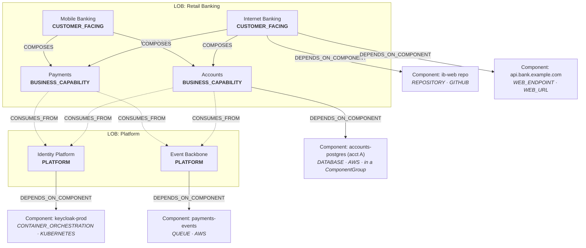

# Digital Products: Types, Composition, and Worked Examples

Componode models your organization's software as **Digital Products** —
curated, human-authored things that the business delivers or operates. Every
digital product has a **type** (`BUSINESS_CAPABILITY`, `PLATFORM`, or
`CUSTOMER_FACING`) and is wired to other products and to imported
**Components** through typed edges.

This guide explains each type in plain English, classifies four familiar
systems (internet banking, ERP, e-commerce, CRM), and shows how products are
built from building blocks. The rules themselves are ratified in
[ADR-018](https://github.com/Componode/componode/blob/main/researches/adrs/ADR-018-product-types-enum-with-enforced-composition-rules.md)
and
[ADR-109](https://github.com/Componode/componode/blob/main/researches/adrs/ADR-109-composes-parent-restriction-removed.md);
the canonical vocabulary is
[CONTEXT.md](https://github.com/Componode/componode/blob/main/CONTEXT.md).

## The vocabulary in one paragraph

- **Digital Product** — the curated thing: an app, a capability, a shared
  platform. You create it; importers never do.
- **Component** — a building block an importer *found*: a repo, a database, a
  Kubernetes deployment, an API endpoint.
- **Component Instance** — a concrete deployment of a component in one
  environment (`DEV` … `PRODUCTION`), with its own operational status.

Importers fill in what *exists* (components, instances). Humans decide what it
*means* (products, hierarchy, ownership).

## The three product types

| Type | Plain meaning | Think of it as |
|---|---|---|
| `BUSINESS_CAPABILITY` | Something your business **does** | "Payments", "Onboarding", "Fraud Detection" — owned by a Line of Business |
| `CUSTOMER_FACING` | Something your customers **touch** | The app, portal, or storefront they log into |
| `PLATFORM` | Shared machinery that **powers** the others | "Identity Platform", "Event Backbone", "Payment Gateway Platform" — consumed, not browsed |

Two edge types wire products together; only `CONSUMES_FROM` constrains types:



The rules (enforced by the API, not just convention):

- **`COMPOSES`** — "parent is composed of child." Any product type may be a
  parent (ADR-109 — a platform has parts too). The graph is a **DAG**: a
  child can serve many parents, but cycles are rejected
  (`409 CYCLE_DETECTED`).
- **`CONSUMES_FROM`** — "product consumes a shared platform." The target must
  be `PLATFORM`. It is *never* drawn inside the composition tree — it's a
  different kind of relationship.
- **`DEPENDS_ON_COMPONENT`** — "the product depends on this component." Any
  product can depend on any component — or on a whole `ComponentGroup`
  (ADR-110), in which case every current and future member counts.

Why two relationships for products? `COMPOSES` answers "what is this product
*made of*?" while `CONSUMES_FROM` answers "what shared platform does it *run
on*?" A platform product isn't a part of your product the way a
sub-capability is — it's governed separately, has its own owner, and gets
consumed by everyone.

## Classifying real systems

The same kind of software can land on different types depending on the role
it plays **in your catalog**. These are the teaching cases.

### Internet banking → `CUSTOMER_FACING`

The internet banking app is what customers literally open. It's
`CUSTOMER_FACING`, and it's *composed of* business capabilities:



Customers don't see "Accounts" or "Identity Platform" — they see one app.
But inside, the app is built from capability products, and those products
consume shared platforms run by other teams.

### ERP → usually `PLATFORM`

An ERP (SAP, NetSuite, Dynamics) is shared machinery: finance, HR, and
procurement products all consume it. In most catalogs it's a `PLATFORM`:



When would it be `BUSINESS_CAPABILITY` instead? If you model "Enterprise
Resource Management" as a capability your org *provides* — with an owner, a
roadmap, and sub-products — then it's `BUSINESS_CAPABILITY` that can compose
smaller products (Finance Module, HR Module). The type follows the role, not
the vendor brochure.

### E-commerce site → `CUSTOMER_FACING` + capabilities

Same pattern as internet banking:



### CRM → `BUSINESS_CAPABILITY` (usually)

A CRM (Salesforce, HubSpot, homegrown) serves internal users — sales and
support teams — so it models cleanly as a `BUSINESS_CAPABILITY` named for
what it enables: "Customer Relationship Management" or "Sales Operations."



If your CRM instead acts as shared infrastructure that *other* products
consume ("every product gets customer data from the CRM"), type it
`PLATFORM` — again, role over label.

## From products to building blocks

Products are human-authored; components are discovered. The link between them
is `DEPENDS_ON_COMPONENT`: "this product depends on that imported asset."

A **Component** is the logical thing — "the Kafka cluster for payments." A
**Component Instance** is where it actually runs — one row per environment,
each with its own status (`RUNNING`, `STOPPED`, `ERROR`, `GONE`), URL,
region, and version.



So "Internet Banking is down" decomposes into something answerable: the
product is `CUSTOMER_FACING` → composed of `Payments` → which consumes the
`Event Backbone` platform → which depends on `payments-events` → whose
`PRODUCTION` instance is `ERROR`.

## Anatomy of a component inventory

A real solution's factual layer is a grab-bag of discovered assets — source
code, cloud accounts, compute, data stores, queues, edge endpoints — each
classified by `category` / `provider` / `resourceType`. This is what the
importers typically yield for our internet-banking example:

| Layer | Component | `category` | `provider` | `resourceType` |
|---|---|---|---|---|
| Source | `ib-web` repo | `REPOSITORY` | `GITHUB` | `github:repository` |
| Source | `payments-api` repo | `REPOSITORY` | `GITHUB` | `github:repository` |
| Source | Acme organization | `ACCOUNT` | `GITHUB` | `github:organization` |
| Cloud accounts | `prod-bank` AWS account | `ACCOUNT` | `AWS` | `aws:account` |
| Cloud accounts | `bank` Azure subscription | `ACCOUNT` | `AZURE` | `Microsoft.Subscription` |
| Compute | `ib-web` servers | `COMPUTE` | `AWS` | `ec2:instance` |
| Compute | `payments-worker` | `CONTAINER_ORCHESTRATION` | `KUBERNETES` | `apps/v1:Deployment` |
| Compute | `batch-vm` | `COMPUTE` | `AZURE` | `Microsoft.Compute/virtualMachines` |
| Data | `accounts-postgres` | `DATABASE` | `AWS` | `rds:db-instance` |
| Data | `static-assets` | `STORAGE` | `AWS` | `s3:bucket` |
| Data | `payments-events` | `QUEUE` | `AWS` | `kafka:cluster` |
| Endpoints & APIs | `api.bank.example.com` | `WEB_ENDPOINT` | `WEB_URL` | `web:url` |
| Endpoints & APIs | `payments-openapi` | `API` | `API_URL` | `api:url` |
| Endpoints & APIs | `support-mcp` | `MCP_SERVER` | `MCP_SERVER` | `tools/list` |
| Ops | `bank.example.com` certificate | `CERTIFICATE` | `AWS` | `acm:certificate` |
| Ops | `payments-alarms` | `OBSERVABILITY` | `AWS` | `cloudwatch:alarm` |
| Ops | `payments-vault` | `SECRET` | `AWS` | `secretsmanager:secret` |

Everything above is a **Component** — one logical row in the catalog.
`resourceType` stays free-form on purpose: it carries whatever type the
source system calls the thing (`ec2:instance`,
`Microsoft.Compute/virtualMachines`, `apps/v1:Deployment`), while
`category` + `provider` keep it searchable across providers.

### Instances: where each component actually runs

Components are logical; **instances** are concrete. One component can exist
in several environments — or several regions — and each instance carries its
own status, URL, region, and version:



`Component.lifecycle` (`ACTIVE`/`RETIRED`) is the *logical* state — retiring
keeps history; `ComponentInstance.status` (`RUNNING`/`STOPPED`/`ERROR`/`GONE`)
is the *operational* state importers maintain. Default views hide `RETIRED`
components and `GONE` instances.

### Component Groups: same thing, three sources

Sometimes the *same logical asset* shows up as distinct discoveries — e.g.
the payments database appears once per AWS account the importer can see.
Instead of pretending they're one component, keep three `Component` rows and
declare them equivalent with a `ComponentGroup`:



The group is an *organizational* unit for humans — and since ADR-110 it is
also a legal `DEPENDS_ON` target: a product can depend on the group itself,
and the edge expands to whatever components are members *right now* (swaps
and new members propagate without rewiring). Read views deduplicate a
component reached through several paths and show every source ("direct",
"via {group}", "via {product}"). Products still cannot delete a group while
depended on — retire it instead.

Depending on components also gives every product a **derived health**
(ADR-112): the worst instance status across its declared dependencies —
production first — shown as a badge on the product list, detail page, and
the dashboard's attention feed when something is in `ERROR`. Health is
computed on read, never stored, and ignores `GONE` instances and `RETIRED`
components.

## Full worked scenario: a small bank



Notice the DAG property: `Accounts` and `Payments` have **two parents**
(`Internet Banking` and `Mobile Banking`) — allowed, because `COMPOSES` is a
DAG, not a tree. `Mobile Banking` reusing the same capability products is
exactly the point of the model.

## How the pieces grow over time

Two workflows tie this together:

1. **Start flat.** Importers discover components; you create products and add
   `DEPENDS_ON_COMPONENT` edges. "Payments depends on payments-events."
2. **Promote shared things to platforms.** When several products depend on
   the same component, Componode surfaces it: *"payments-events is depended on
   by 4 business products — consider making it a platform product."* The
   Platform Product workflow ([ADR-017](https://github.com/Componode/componode/blob/main/researches/adrs/ADR-017-platform-product-workflow-full-guided-workflow-in-v1.md))
   creates the `PLATFORM` product, rewires the consumers' edges to
   `CONSUMES_FROM`, and assigns an owner — turning ungoverned shared
   infrastructure into a managed product with a team behind it.

   Concretely: the dashboard's **Platform candidates** section lists every
   active component with direct `DEPENDS_ON` edges from **two or more**
   active products (reach via a ComponentGroup doesn't count — only direct
   edges do). Each row names the dependent products so you can inspect the
   blast radius before deciding. **Promote** opens a dialog that creates the
   `PLATFORM` product, wires the platform's own `DEPENDS_ON` edge to the
   component, and presents every current consumer as a checklist — all
   checked by default, but you can opt a product out and it keeps its direct
   edge. The whole promotion is one transaction: either the product, its
   edge, and every consumer rewrite land together, or nothing does. You can
   assign a Line of Business and/or Team owner in the same dialog.
   Promotion isn't limited to the worklist — every active component's
   detail page offers **Promote to platform**, even with zero consumers.

Ownership is org-real, not abstract: every product is owned by a **Line of
Business** and optionally a **Team**/**Person**, which is who gets asked when
the platform changes.

## Bootstrapping the catalog (ADR-114)

The meaning layer doesn't have to start at zero. Three workflows populate it
fast — all curated, all audited, none of them importers:

1. **Import products** (Products → *Import products*) uploads a YAML or JSON
   catalog document to `POST /api/v1/products/bootstrap`:

   ```yaml
   version: 1
   products:
     - name: Payments Shop
       type: CUSTOMER_FACING
       description: Storefront checkout
       owner: { lob: retail, team: shop-platform }   # entity slugs
       tags: [checkout]
       criticality: HIGH
       sunsetAt: "2027-06-01T00:00:00Z"
       dependsOn: [payments-db, arn:aws:rds:db-1]     # component refs
   ```

   The document is validated strictly **before** anything is written — a
   malformed item or unknown field rejects the whole file. Each product then
   applies in its own transaction: upserted by name-derived slug with merge
   semantics (absent fields preserved, present fields applied, explicit
   `null`/`[]` clears), then its `DEPENDS_ON_COMPONENT` edges are wired.
   `owner` refs resolve by LOB/Team slug; `dependsOn` refs resolve by
   component slug, then name, then `externalId`. Unresolved or ambiguous
   refs are reported in `skipped` — never fabricated, and they don't block
   the rest of the file. A `RETIRED` product matched by slug is updated but
   stays retired; a type change that would invalidate `CONSUMES_FROM`
   consumers is skipped, matching the normal update guard. Re-importing an
   unchanged file reports all zeros and writes no audit rows — the import is
   idempotent. `?dryRun=true` returns the identical report with zero writes;
   the dialog runs it automatically on file selection before you hit *Apply*.

2. **Create product from components** (Components list) — check any ACTIVE
   component rows, click *Create product*, and the new product is wired to
   every selection in one transaction.

3. **Bulk dependency wiring** (product detail → *Add dependency*) — the
   picker now takes a checked set of components in one `componentIds[]`
   request, or a single component group — never both. Components the product
   already depends on stay visible but disabled.

## Staged edge suggestions (ADR-113)

Importers fill the factual layer, but the meaning layer still starts empty —
somebody has to wire every `DEPENDS_ON` edge. Suggestions close most of that
gap without ever auto-authoring a relationship: the server computes
**candidate edges** from stored catalog data, stages them as `PENDING` rows,
and a human decides each one in the *Suggestions* queue.

**The signals.** Every generation pass scores each active
product × component pair on three ratified signals:

| Signal | What matches | Score |
|---|---|---|
| `NAME_MATCH` | Token overlap between the product name and the component name/slug | 1.0 on containment, 0.5 on any shared token |
| `TOPIC_TAG_MATCH` | Product tags/name tokens vs component `tags` + `details.topics` | 0.5 first hit, +0.1 each extra, cap 0.8 |
| `NAMESPACE_MATCH` | Product name tokens vs a Kubernetes component's `details.namespace` tokens | 0.6 |

A pair hitting multiple signals keeps the strongest reason and gets a small
multi-signal bonus (+0.05 each, cap +0.1). Pairs below the 0.5 floor are
never staged.

**The lifecycle.** One row per `(product, component)` pair:

```
PENDING ──accept──▶ ACCEPTED   (real edge wired via the normal edge path
                                + its standard audit entry)
PENDING ──dismiss─▶ DISMISSED  (permanent — never suggested again)
*       ──covered─▶ SUPERSEDED (pair became a real or group-covered edge
                              by other means)
```

Only `PENDING` is live. Decided rows are terminal: they never return to
`PENDING`, there is no un-dismiss, and a pair that was once a real edge
keeps a `SUPERSEDED` tombstone so deleting the edge later can never
regenerate the suggestion. Pairs already covered through a `ComponentGroup`
dependency are suppressed the same way — the queue only ever shows work a
human would actually want.

One caveat on tombstones: they are written when the edge itself is written.
A pair that was wired **before** this feature existed and removed before any
generation pass observed it leaves no tombstone, so a *Rescan* may re-stage
it once — dismiss it and the dismissal is permanent.

**When candidates appear.** Generation runs after a successful import run
(failed/cancelled runs stage nothing), on product creates and name/tag
updates, on component tag or group changes, after a catalog bootstrap apply
and a platform promotion, and on demand via *Rescan* — the backfill path for
catalogs that predate the feature. Pending rows that stop matching stay put:
rescoring a suggestion is fine, un-deciding a human's queue is not.

**The queue** (`/suggestions` in the Catalog nav) lists pending candidates
sorted by score with the reason chip (`Name match`, `Topic/tag match`,
`Namespace match`), product and component links, and Accept/Dismiss actions
for `EDITOR+`. The Dismissed filter is the permanent decision history —
reason, score, who dismissed it, and when. Accepting wires the edge through
the exact same service and audit path as manual wiring; dismissing records
the decider and is irreversible by design.

## Catalog coverage and hygiene

Componode derives a read-only **coverage layer** over the catalog (spec 023).
Nothing is persisted or recomputed offline — every figure is computed on the
read, so it can never go stale.

- **Dashboard — Catalog coverage**: wired share of the default-visible
  component set (`ACTIVE`, not instances-all-`GONE`), plus the count of
  non-retired products missing an owner, a dependency surface, or a
  description. Every figure links to the matching filtered worklist; a zero
  denominator renders `—`, not `0%`.
- **Component wiring**: a component is *wired* when a non-retired product
  reaches it through `DEPENDS_ON` — direct or via a `ComponentGroup`. Pending
  edge suggestions never count. `/components?wired=unwired` is the gap
  worklist and always agrees with the dashboard count.
- **Product completeness**: three independent facets — owner, description,
  dependency surface — shown as a chip on product rows and the detail header.
  The dependency surface is non-empty when the product has its own
  `DEPENDS_ON`/`CONSUMES_FROM` edges *or* any non-retired `COMPOSES`
  descendant declares dependencies. `/products?missing=owner,description,…`
  filters by gap (values OR'd). There is no score — each facet stays visible
  on its own.
- **Platform consumers**: `PLATFORM` rows and the platform detail show the
  `consumedByCount` — products holding a `CONSUMES_FROM` edge on it.
- **Sunset attention**: non-retired products and components whose `sunsetAt`
  has passed appear in the dashboard attention feed, below operational
  items, and link straight to the entity.

## Practical metadata

Beyond names, owners, and edges, every Digital Product and Component carries
four optional, human-curated metadata fields. All of them are optional —
start flat, add context where it pays off. Importers never touch them, so
curation survives every reconcile.

| Field | Where | What it is |
|---|---|---|
| **Links** | products + components | Ordered `{ title, url }` references — runbooks, repos, dashboards. Max 20, http(s) only. |
| **Tags** | products + components | Lowercase free-form labels (`pci`, `payments`, `tier-1`). Max 20; filter lists with a single exact tag. |
| **Criticality** | products only | `CRITICAL \| HIGH \| MEDIUM \| LOW` — a triage hint for humans, nothing more. |
| **Sunset** | products + components | An optional `sunsetAt` date announcing planned decommission. |

Sunset is deliberately *display-only*: a passed date renders an "overdue"
badge but never auto-retires anything. Retirement stays a human decision
(`ACTIVE → RETIRED` is reversible). The badge states:

- More than 30 days out → neutral `Sunset {date}`
- Within 30 days → amber `Sunset in {n}d`
- Past while still `ACTIVE` → red `Sunset overdue`
- `RETIRED` entities never show overdue — they already transitioned

## Common classification questions

**"Is this a product or a component?"**
Ask who owns it. If a team owns it and you describe it in business terms — a
name stakeholders recognize, edges a person deliberately wired — it's a
Digital Product. If an importer could discover it (a repo, a database, a
Kubernetes deployment, an endpoint), it's a Component. A microservice can be
both: the *logical service your team ships* is a product; the *deployment the
Kubernetes importer found* is a component. The two coexist — the product
`DEPENDS_ON_COMPONENT` the component.

**"Where does Stripe / SendGrid / vendor SaaS go?"**
A manually created **Component** with `provider: OTHER` — an external
building block your products depend on. Group it in a `ComponentGroup` if the
same service appears under several sources. Promote it to a `PLATFORM`
product only when your organization actually governs it — a dedicated owner
and named consumers — rather than merely paying for it.

## Quick reference

| Question | Answer |
|---|---|
| Customers log into it? | `CUSTOMER_FACING` |
| It's "something the business does"? | `BUSINESS_CAPABILITY` |
| Other products consume it as shared machinery? | `PLATFORM` |
| Owned, business-meaningful thing? | `DigitalProduct` |
| An importer could discover it? | `Component` |
| Vendor SaaS (Stripe, SendGrid)? | `Component` with provider `OTHER` |
| "Parent is made of child" | `COMPOSES` (any type, DAG) |
| "Runs on a shared platform" | `CONSUMES_FROM` (target: PLATFORM) |
| "Needs this imported asset" | `DEPENDS_ON_COMPONENT` |
| Where does it run? | `ComponentInstance` per environment |
| Same asset in 3 accounts = one logical thing? | `ComponentGroup` |

## Related documents

- [CONTEXT.md](https://github.com/Componode/componode/blob/main/CONTEXT.md) — canonical vocabulary and `Avoid:` terms
- [docs/architecture.md](architecture.md) — runtime architecture and ER model
- [docs/api.md](api.md) — product/edge endpoints and validation errors
- [researches/architecture-decisions.md](https://github.com/Componode/componode/blob/main/researches/architecture-decisions.md) — ADR index (ADR-015…019, ADR-049/050)
