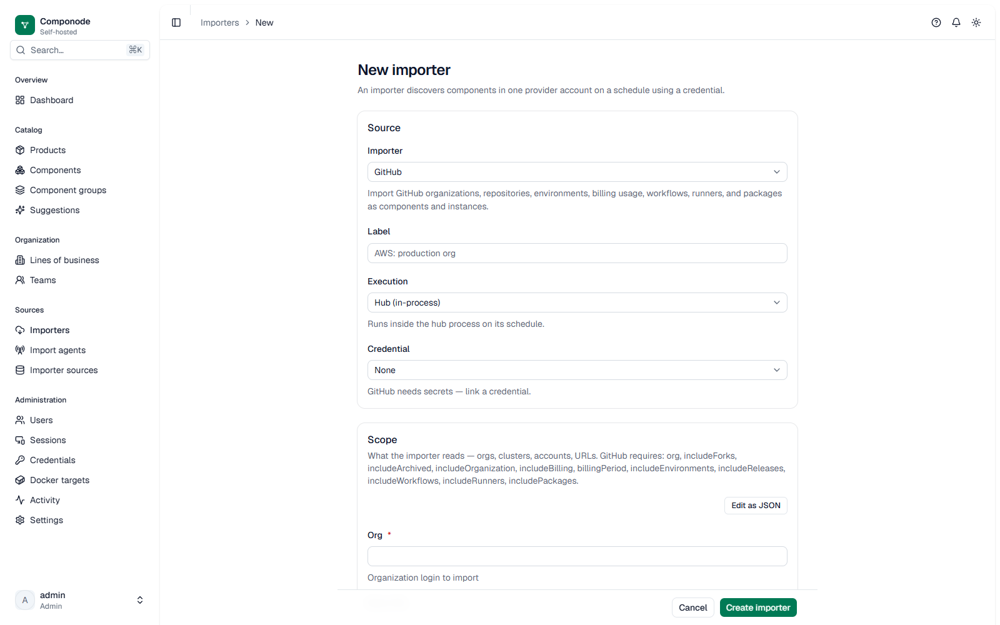

# GitHub importer

Imports a GitHub organization — its profile, repositories, environments,
releases, workflows, self-hosted runners, packages, and billing usage — as
catalog components.

## What it creates

- One **organization component** carrying the coverage/capability summary.
- One **component per repository**. Its details carry the repository facts
  (default branch, fork provenance, size, license, timestamps) plus, by
  default, the full **branch inventory** (every branch with commit SHA,
  protection state, and default-branch flag), the **release and tag
  inventory**, and per-repo capability markers — all visible on the
  component page under the GitHub section.
- **Instances** for deployment environments (mapped to Componode
  environments) and for branches whose names resolve through
  `environmentMapping` — the mapping is the selector for branch instances,
  so unmapped branches appear in the inventory but never as instances.
  Workflows, deployments, and the latest-release fallback feed instance
  versions depending on which sections you enable.

## Prerequisites in GitHub

1. **Choose the organization** you want to import (`org` config field).
2. **Create a personal access token**:
   - *Classic PAT* — minimum scopes `repo` and `read:org` for the org profile,
     repos, teams, environments, releases, and workflows. Add `admin:org`
     for billing usage, self-hosted runners, and packages.
   - *Fine-grained PAT* — grant organization read access plus
     Administration read for the org-level sections; billing/runners/packages
     need organization administration access.
3. If your org enforces **SAML SSO**, authorize the token for the
   organization after creating it.
4. For **GitHub Enterprise Server**, set `baseUrl` to your instance's API URL
   (`https://<ghes-host>/api/v3`). HTTPS is required.

## Credentials

| Secret key | Required | How to get it |
|---|---|---|
| `token` | Yes | GitHub → Settings → Developer settings → Personal access tokens |

Use the credential **Test** action after saving — it calls the rate-limit
endpoint, the smallest authenticated request available.

## Configuration

<!-- GENERATED:contract -->
**Secrets:** `token` (required)
**Execution:** hub or Import Agent
**Source identity:** `context.reportSourceIdentity()`

| Field | Type | Required | Default | Description |
|---|---|---|---|---|
| `org` | string | yes | — | Organization login to import |
| `baseUrl` | URL | no | — | GitHub Enterprise API base URL (github.com when unset) |
| `repos` | string[] | no | — | Restrict to named repositories (all when unset) |
| `includeForks` | bool | no | `false` | Include forked repositories |
| `includeArchived` | bool | no | `false` | Include archived repositories |
| `includeOrganization` | bool | no | `true` | Emit the organization component |
| `includeBilling` | bool | no | `true` | Fetch billing usage (needs `admin:org`) |
| `billingPeriod` | enum | no | `current` | Which billing month to read |
| `includeEnvironments` | bool | no | `true` | Import deployment environments |
| `includeReleases` | bool | no | `true` | Import latest release per repo |
| `includeWorkflows` | bool | no | `false` | Import Actions workflows per repo |
| `includeRunners` | bool | no | `false` | Import org self-hosted runners (needs `admin:org`) |
| `includePackages` | bool | no | `false` | Import org packages (needs `admin:org`) |
| `includeBranchInventory` | bool | no | `true` | Import the full branch inventory into component details |
| `includeBranchActivity` | bool | no | `false` | Fetch last-commit timestamps per branch (one extra API call per branch) |
| `includeBranchInstances` | bool | no | `true` | Emit environment-mapped branch instances (spec-011 semantics) |
| `includeReleaseInventory` | bool | no | `true` | Import releases and tags inventory into component details |
| `includeLanguageBreakdown` | bool | no | `false` | Import per-language byte breakdown (one extra API call per repo) |
| `environmentMapping` | record | no | — | Map GitHub environment names to DEV/TEST/STAGING/DEMO/PRODUCTION/OTHER |
<!-- /GENERATED:contract -->

## Behavior notes

- **Branches are inventory, not instances.** Every branch of an imported
  repository lands in the component's `details.branches` (name, SHA,
  protected flag, default-branch flag, optional last-commit activity).
  Only branches whose names resolve through `environmentMapping` also emit
  `branch:*` instances — `main`/`master` are never implicitly production.
  Set `includeBranchInstances: false` to suppress those instances while
  keeping the inventory, or `includeBranchInventory: false` to skip the
  inventory fetch entirely.
- **`includeBranchActivity` costs one API call per branch** (it enriches
  each entry with the last commit timestamp). Leave it off for large orgs.
- **`includeReleaseInventory`** (default on) pages through *all* releases
  and tags — independent of `includeReleases`, which only feeds the
  latest-release version fallback for environment instances.
- **`includeLanguageBreakdown`** (default off) adds one
  `GET /repos/{o}/{r}/languages` call per repository.
- Sections the token can't reach degrade to `capabilities.*` markers —
  per-repository under `details.capabilities` on each repo component and
  aggregated (worst-status-wins) on the organization component — the run
  still succeeds and the component page shows an incomplete-data notice.
  Check `details.capabilities` if a section is missing. Token scope notes:
  branch/tag/release/language inventory needs **Contents: read**;
  environments need **Actions: read**; deployments need **Deployments:
  read**; protection-rule *detail* beyond the protected flag needs
  Administration read and is not fetched.
- Large orgs with `includeWorkflows`/`includePackages`/`includeRunners` make
  substantially more API calls; enable them only if you need them.

## Troubleshooting

| Symptom | Likely cause |
|---|---|
| Run fails during "Authenticating" | Token invalid/revoked, or not authorized for a SAML org |
| `capabilities.billing` = `FORBIDDEN` | Token lacks `admin:org` — expected for read-only setups |
| Empty repo list | Wrong `org` name, or token can't see private repos (needs `repo`) |
| `baseUrl` rejected | Must be HTTPS and not a private/loopback address |

## Source identity

Identity is `{canonicalApiBaseUrl}org/{orgId}` — the org is fetched before any
asset is yielded, so an empty inventory still registers the Source. When org
details are unreadable the identity falls back to `{base}login/{org}` (mirroring
the org asset's own `login:` externalId fallback). github.com `externalId`s
are unchanged; GHES deployments qualify them with the source identity
(`{base}/org/{id}::{externalId}`) on the first adopted run because numeric
IDs collide across GHES instances. No migration backfill (the org id needs a
live API call) — existing orgs adopt on their next run.
