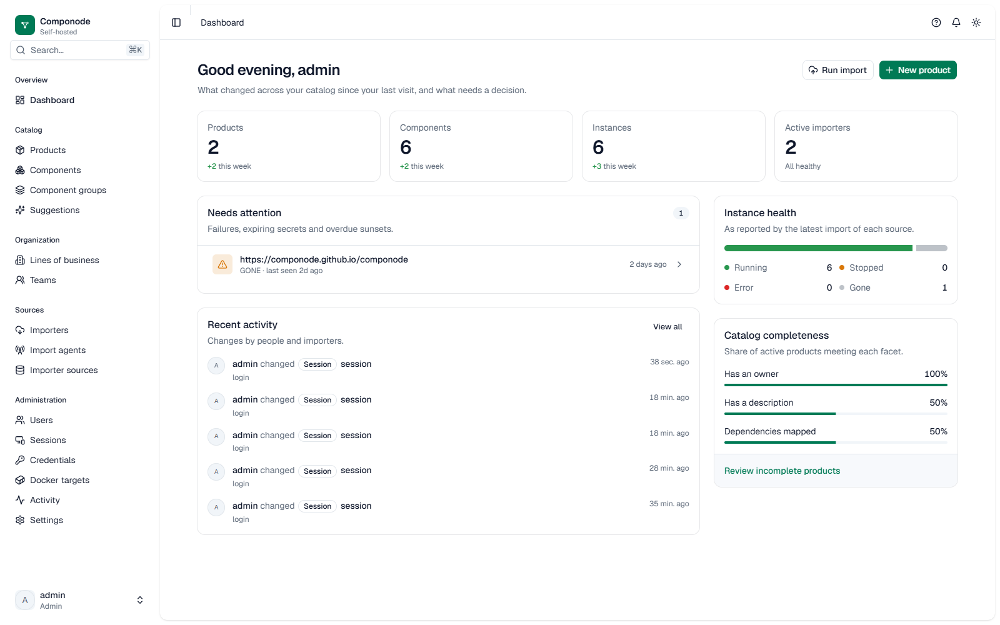

::: tip About this project
Componode is a personal learning project. It was built to explore, hands-on,
how applications are developed today with AI coding assistants — the tooling,
the workflows (spec-driven development, ADRs, changesets), and the
architecture decisions that come with a real codebase.

It was not built by a professional developer, so expect rough edges — and it
is **not a production-grade solution**. If you spot something questionable,
please [open an issue](https://github.com/Componode/componode/issues) and say
so. That's how this project gets better.
:::

## Where to go next

| I want to… | Start here |
|---|---|
| Try it in 15 minutes | [Quickstart](./quickstart) |
| Understand what Componode models | [Digital Products in depth](./digital-products) · [Vocabulary](./vocabulary) |
| Learn what each screen does | [Using the catalog](./using-the-catalog) |
| Manage users, roles, secrets | [Credentials & access](./credentials-and-access) |
| Run it for real | [Deployment](./deployment) |
| See what an importer needs | [Importers overview](./importers/) |
| Reach a private network | [Import Agents](./import-agents) |
| Fix something broken | [Troubleshooting & FAQ](./troubleshooting) |
| Call the API | [Interactive OpenAPI](./openapi-reference) · [API conventions](./api) |
| Understand how it's built | [Architecture](./architecture) · [Contributing](./contributing) |
| See what's next | [Roadmap](./roadmap) |
