# Using the catalog

A tour of what each part of the app does, and the mental model behind it.
If a term is unfamiliar, the [vocabulary](./vocabulary) defines it — and
[Digital Products in depth](./digital-products) walks through worked
examples.

## The two layers

Everything in Componode belongs to one of two layers:

- **Factual layer** — what _exists_, imported by importers: Components and
  their Instances. Importers report; the core upserts, deduplicates, and
  reconciles. You mostly _read_ this layer.
- **Meaning layer** — what it _means_, curated by humans: Digital Products,
  composition edges, ownership, groups. You mostly _write_ this layer.

The app mirrors this split: **Sources** (importers, runs, agents, sources)
feeds the factual layer, and **Catalog** (products, components, groups,
suggestions) is where meaning gets built on top.

## Dashboard

**Dashboard** (`/`) — the landing view after sign-in. It summarizes what
changed since your last visit and what needs a decision:

- **Catalog totals** — products, components, instances, and active
  importers, with this-week deltas.
- **Needs attention** — a worklist of failures, expiring secrets, `GONE`
  instances, and overdue sunsets.
- **Instance health** — RUNNING/STOPPED/ERROR/GONE counts as reported by
  the latest import of each source.
- **Recent activity** and **catalog completeness** — the audit tail plus
  how many active products have an owner, a description, and wired
  dependencies.

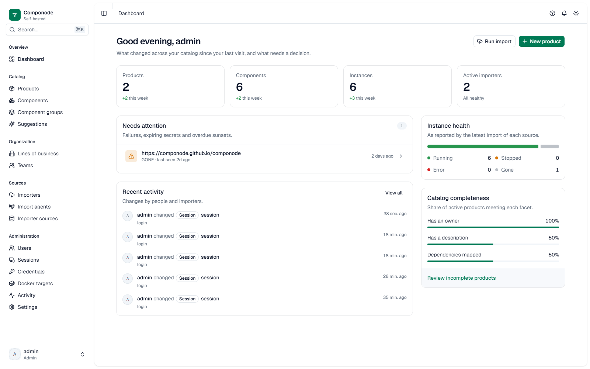

## Catalog

**Products** (`/products`) — the curated hierarchy. A Digital Product has a
type (`BUSINESS_CAPABILITY`, `PLATFORM`, `CUSTOMER_FACING`), an owner (Line
of Business, Team, Person), and edges:

- `COMPOSES` — product → product ("parent is composed of child"). A DAG;
  cycles are rejected at write time.
- `CONSUMES_FROM` — product → `PLATFORM` product ("consumes this shared
  platform").
- `DEPENDS_ON` — product → component **or** component group.

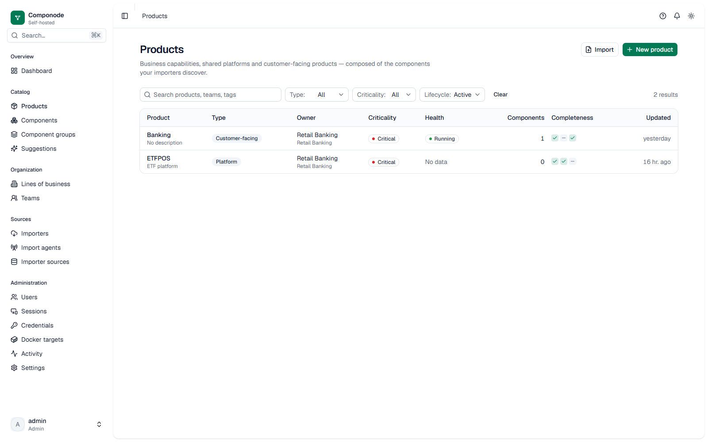

The product detail's dedicated **Map** tab opens a read-only, one-hop
topology: products that compose or consume this one, products it composes or
consumes from, and the components and groups it depends on — each in its own
labeled lane with `+N` expansion and an inspect panel. Components reached
through a group stay inside the group node. The **Dependencies** tab keeps
list-form edge authoring, consumers, and suggested relationships.

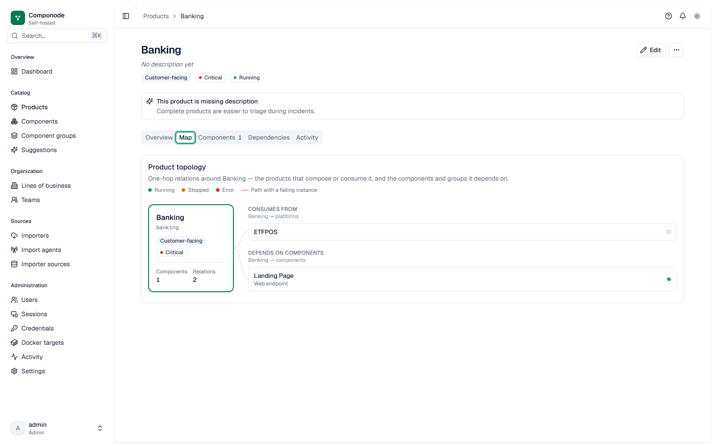

New to the model? Start with [Digital Products in depth](./digital-products).

**Components** (`/components`) — imported assets: repositories, workloads,
databases, endpoints. Each has a controlled `category` + `provider` and a
free-form `resourceType` (e.g. `ec2:instance`). Retired components are
hidden by default; use the filters to include them.

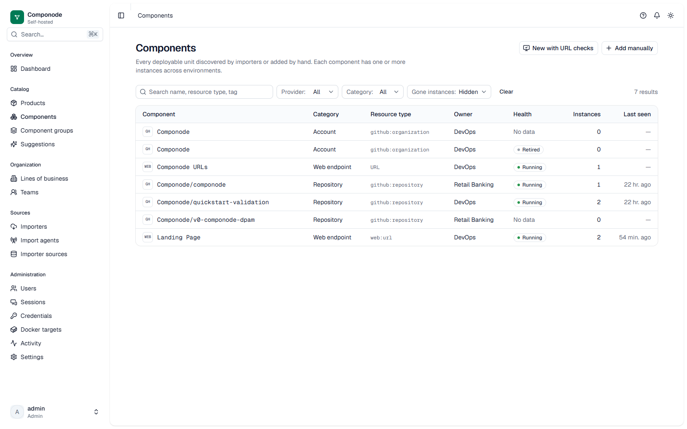

**Component Instances** — inside a component's detail page. One component
has many instances, one per environment (`DEV` … `PRODUCTION`), each with
operational status (`RUNNING`/`STOPPED`/`ERROR`/`GONE`). A resource that
disappears from the source becomes `GONE` — it's marked, not deleted. A
manually created `ACTIVE` Component with no instances offers **Add first
instance** from its URL checks card — a focused recovery path that saves
one environment without creating a second Component. URL checks
themselves are declared on a Web/API ImporterConfig and materialize on
import runs; the card is read-only and links to the owning configuration.

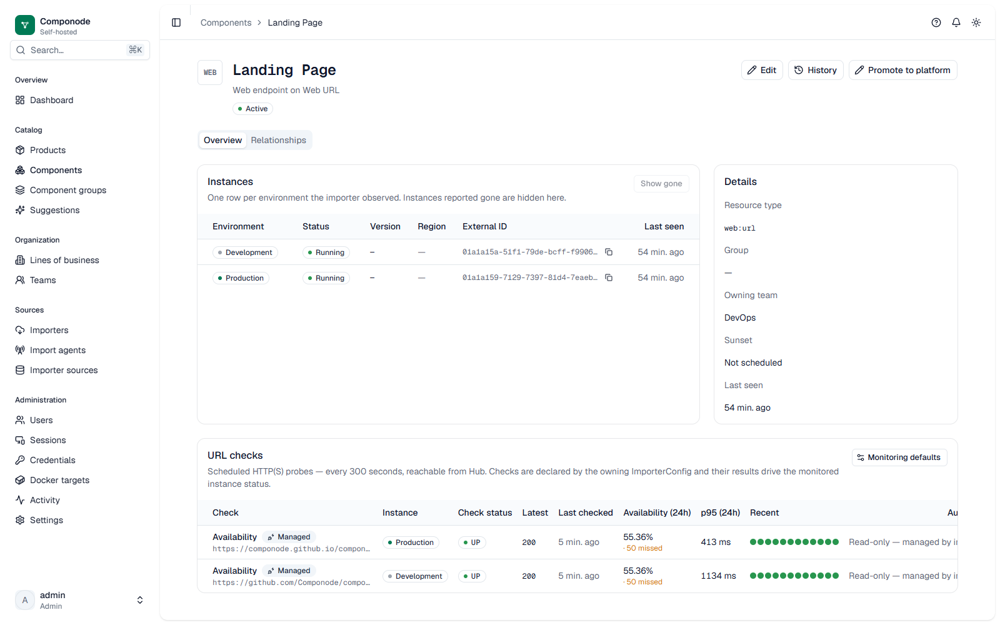

**Component Relationships** — the component detail's **Relationships** tab
is a read-only, one-hop view of everything stored about a component: typed
Component relations in both directions (`DEPENDS_ON`, `SOURCES_FROM`,
`EXPOSES`), Products that depend on it — directly or *via* a named
ComponentGroup — and its instances nested with environment and status.
Lanes show four entries with `+N` expansion; nodes are keyboard-operable
(Enter/Space to inspect, Escape to clear). Empty lanes are honest empty
states, not errors — the view never infers relations.

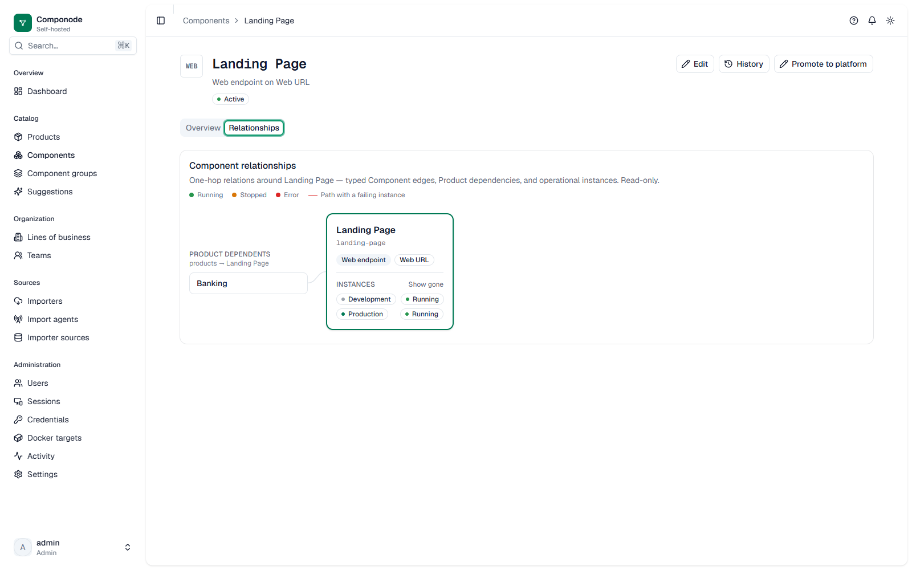

**Component Groups** (`/component-groups`) — human-declared equivalences:
"these three imported things are the same logical component." Products can
depend on a group instead of a single component.

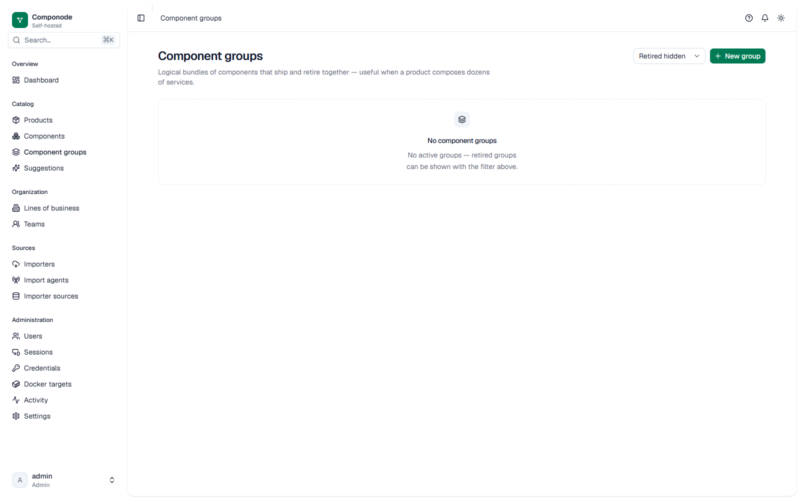

**Suggestions** (`/suggestions`) — the staged edge queue. The server
proposes `DEPENDS_ON` candidates from import data; a human accepts or
dismisses each one. Nothing is ever auto-wired — decided pairs are
terminal.

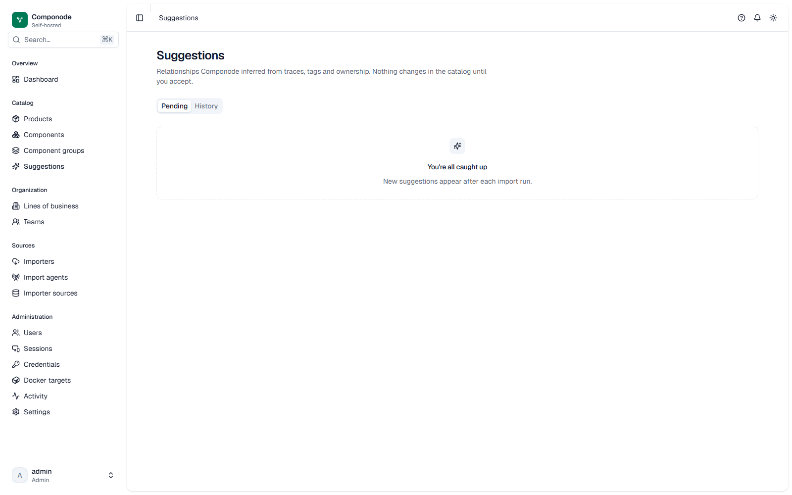

## Sources

**Importers** (`/importers`) — one config per source you want to pull from:
importer type + credential + scope fields. Runs execute in the background
with phases, errors, and a result summary. See the
[importers overview](./importers/) for what each one discovers.

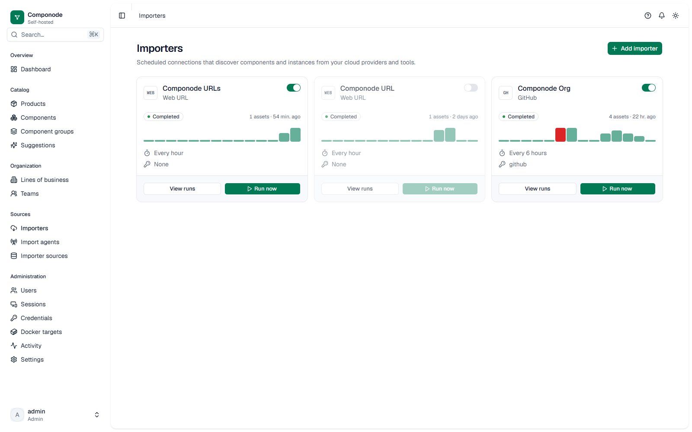

**Import Agents** (`/agents`, admin) — remote runtimes that run importers
inside networks the hub can't reach. See [Import Agents](./import-agents).
Target-capable importers (Docker) can also run on the hub against **managed
targets** — allowlisted connection profiles admins maintain under
Administration; a disabled target blocks new runs without deleting it.

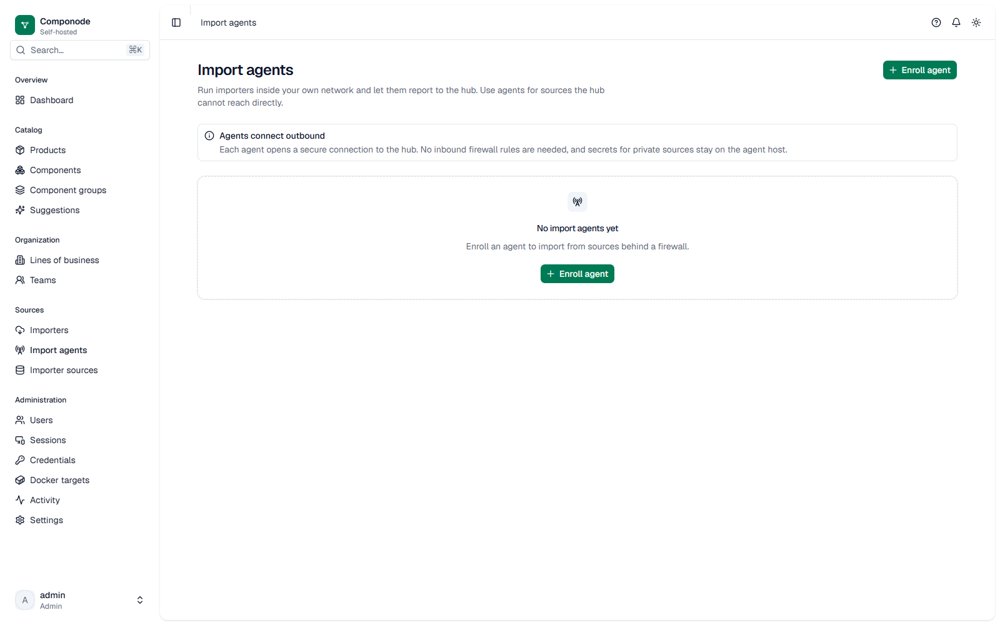

**Sources** (`/sources`) — provenance records: which importer source each
component/instance membership came from, and its monitoring state. This is
what makes reconciliation source-scoped — deleting a config stops
monitoring instead of erasing history.

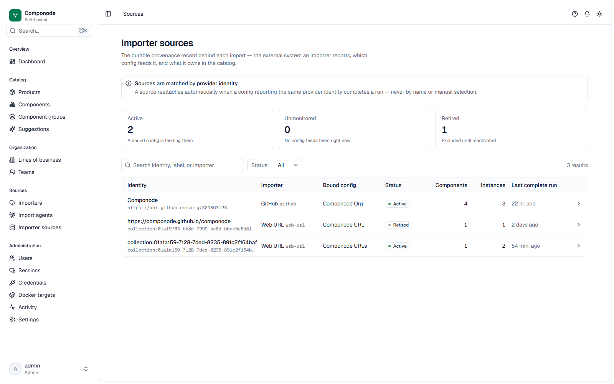

## Organization

**Lines of Business, Teams, People** (`/lobs`, `/teams`, `/users`) — the
ownership entities products and groups reference. People double as login
accounts with roles; see [Credentials & access](./credentials-and-access).

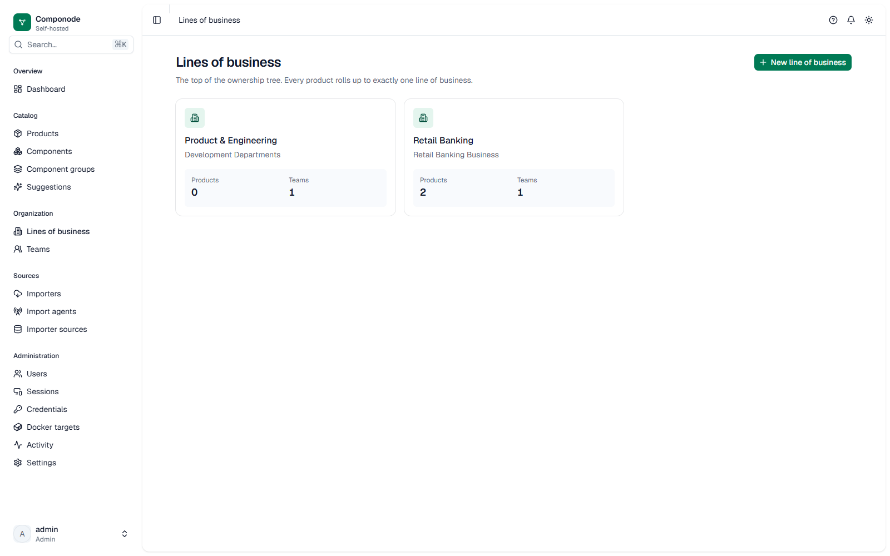

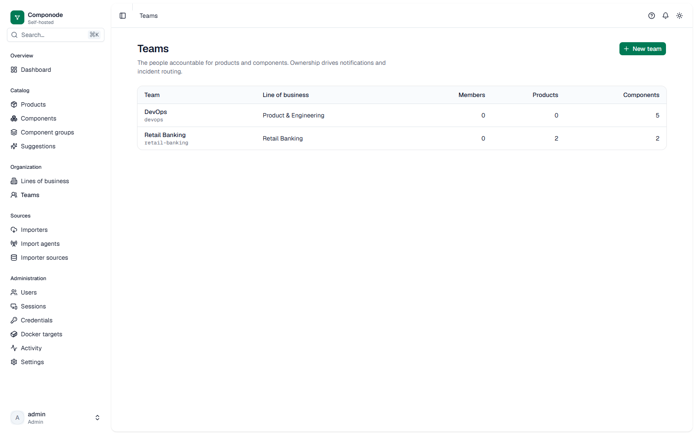

## Administration

Management screens live under **Administration** — most are admin-only:
**Users** (people, roles, activation), **Credentials** (the
[encrypted secret store](./credentials-and-access)), **Docker targets**
(managed connection profiles for hub-side Docker imports), **Activity**,
and **Settings** (workspace, authentication, session policy, appearance,
notifications). **Sessions** lists your own sign-ins and lets you revoke
them.

**Activity** (`/activity`) — the immutable audit feed: every change to
curated entities, every sign-in, and every import, with actor and
timestamp. Retained for one year.

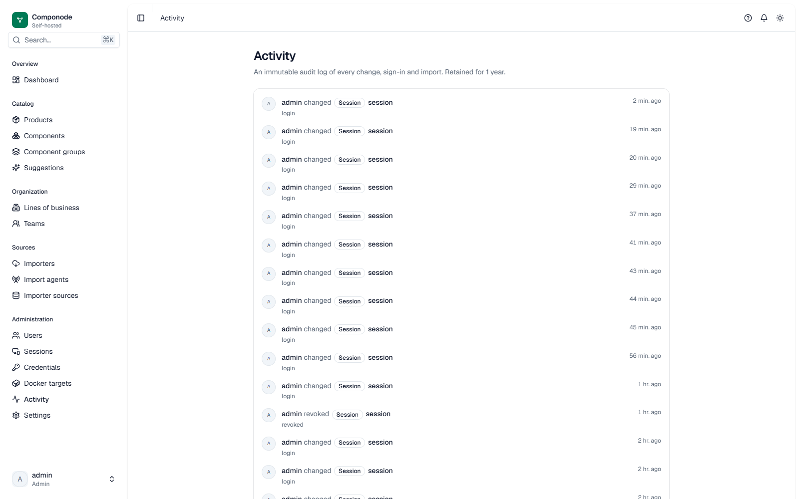

## Common workflows

- **Bootstrap an existing inventory** — Products → Import accepts a
  YAML/JSON file describing your current application landscape, so you
  don't wire the catalog from zero.
- **Promote a component to a platform product** — a guided flow on the
  component page for "this building block is actually a shared product."
- **Review coverage** — the dashboard summarizes how much of the factual
  layer is wired into products, plus worklist filters for gaps and
  sunset-overdue items.
- **Retire, don't delete** — retiring is the reversible default
  (`ACTIVE → RETIRED`); hard delete exists only for products with no
  edges.
